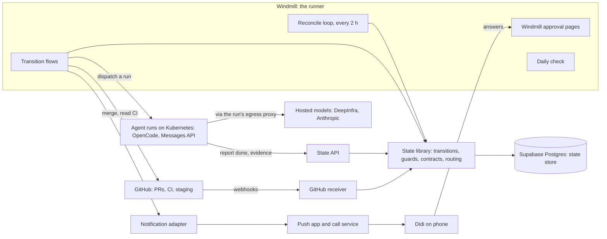
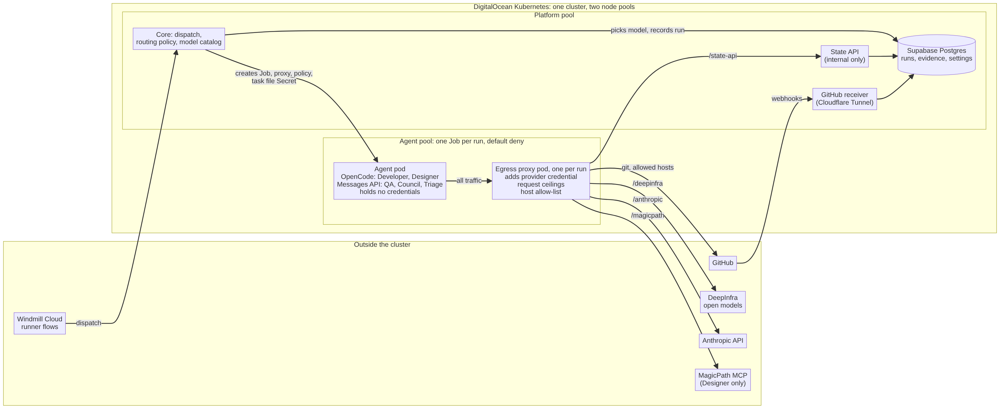

# Technical architecture

Status: draft, 2026-10-28. Items marked Proposed need an ADR and review. Items marked To verify need a spike before anything depends on them.

## 1. Overview

Four ideas shape the design:

1. The state store is the source of truth. Every other thing (Linear, approval pages, push alerts, the daily check, a future frontend) renders it.
2. The runner decides every transition. A transition is a guarded, transactional write. Agents propose by reporting; they never write state.
3. Contracts are data. Guards, evidence, timeouts and fallbacks are loaded at a version, not hard-coded in flows.
4. Plumbing is plain code. Models do judgment inside a state and nothing else.

## 2. Components

### 2.1 State library (core, plain TypeScript)

- Pure logic with no Windmill or HTTP dependency. Takes a store interface, a contracts object, a clock and an id source. It never reads the time or makes random values itself, so the same input always gives the same result (D-162).
- Exposes operations: create node, add edge, record evidence, record decision, open or supersede a gate request, request transition, run the reconcile pass, and read views (attention list, daily check data).
- `requestTransition(nodeId, toState, trigger, actor)` loads the node, finds the contract for the move, evaluates the guard against recorded evidence, and on success writes the transition row and updates the node in one transaction with the version check. It returns the result and the guard report.
- Everything else (flows, API, adapters) is a thin shell around it. This is where most tests live.

### 2.2 State store

Managed Postgres: Supabase in `ca-central-1` (ADR 0103). Schema in ADR 0104 and `db/migrations/`, in the `factory` schema with row level security on. Append-only tables are protected by triggers that reject UPDATE, DELETE and TRUNCATE for every role, and no application role has DELETE. Revisit when there is a Kubernetes cluster with a vault and replicas.

### 2.3 State API (tiny, Proposed)

A thin HTTP API over the library for agents, the viewer and adapters: create idea, record decision, report done with evidence, read a node, read the attention list. Hosting options for the M0 ADR: Windmill scripts exposed as endpoints, or a small service (for example a plain Node service; a Worker is allowed only if the code stays portable). Choose the simplest option that keeps agents from touching the database directly, and keep Cloudflare-specific APIs out of the API and the library (D-132). Agents authenticate with their own identity and can only write what their role allows.

Starting a flow (D-283, D-284, D-328, O-101): after a plan submission is recorded, the state API starts `f/foreman/plan_approval` itself, with a Windmill token that can start only that flow, through the shared Windmill egress proxy in the platform namespace. The GitHub receiver does the same for `f/foreman/option_capture` after it records CI's end on a design item's PR head, only when capture's own due check says a capture is due, with its own token limited to its flows (D-291, D-327). After the same event it starts `f/foreman/advance_item` when the item's move into In QA review is due (the advance check the reconcile pass shares, `src/core/advances.ts`), and after a `workflow_run` `completed` with conclusion `success` for `.github/workflows/ci.yml` started by a push to the default branch of the repository itself, it starts `f/foreman/deploy_staging` with the repository and the run's id (D-353, D-356, O-116). A `deployment_status` starts nothing any more. Apart from CI's path, after a `workflow_run` `completed` for Bootstrap started by `workflow_dispatch` in a repository of didi-build, it starts `f/foreman/remove_bootstrap_access` with the repository (D-358, O-114). Each check reads only what the receiver's role reads; a check that needs more fails closed and starts nothing. Every start is checked first, so a replay, a pending result and the switches start nothing. The run watcher is the proxy's third caller: it starts `f/foreman/record_run_end` when a run's Job stops, with a token that can start only that flow (D-330, O-102, section 2.8). No caller reaches public 443 directly; the proxy allows only Windmill's host and holds no credential. A failed start changes nothing the service recorded, and the reconcile pass catches up.

### 2.4 Runner (Windmill)

- One flow per transition, plus the reconcile flow, event handlers for webhooks, and the daily check flow. Windmill's flow format is acyclic, and our machine has cycles (a QA failure sends work back), so durable state lives in the store and each flow handles exactly one transition.
- Flows are small. They call the library, call adapters, and write results. They contain no business rules.
- Every flow is idempotent. A repeated webhook or a retried run produces the same final state.
- Approval steps suspend a flow until resumed through a URL. They are the primary channel for gate approvals in v1 (To verify on a phone).
- A project is registered with one form Didi runs signed in to Windmill, `f/foreman/register_project` (D-345, O-109): the slug and a one-line description. It refuses a slug not listed in the platform settings file on main, creates `didi-build/<slug>` from the `didi-build/launchpad` template, always public (D-348), and records the project row. The runner App creates the repository with a token minted for that one step, narrowed to the template and to "Contents: read" and "Repository creation: write" (D-346). Launchpad's Bootstrap workflow then sets up the repository. The organization secret `BOOTSTRAP_TOKEN` is shared with selected repositories only, normally none, so Bootstrap's first run, at creation, has no token (D-358 lock (2), O-114). Once the project is recorded, the form adds the repository to the secret's selected repositories and starts Bootstrap again on main, each with a token narrowed to the new repository. When that restarted run ends, whatever its conclusion, the GitHub receiver starts `f/foreman/remove_bootstrap_access`, which removes the repository, and the reconcile pass removes any repository on the list that is not a project registered less than an hour ago whose setup has not finished. Setup has finished once the newest Bootstrap run started by `workflow_dispatch` completed; GitHub keeps the runs, so the form, the backstop and the daily check read it there with the runner App's `actions: read` token. The daily check says "Bootstrap failed for <slug>; run the register form again" when that run failed, and the form run again grants and restarts again.

### 2.5 Reconcile loop

Runs every 2 hours until Kubernetes exists, then every 5 minutes once Windmill is self-hosted (setting `reconcile_interval_minutes`, D-111, D-164). It is the backstop for missed events. The runner counts Windmill executions per month and alerts Didi at 80% of the free limit (P-21). Each pass does, in order:

1. If `kill_switch` is true, stop.
2. Release: for each Blocked node whose blockers are all Done (and whose design spec is merged where required), request the transition to Ready.
3. Dispatch: for each node that is ready but has no active run, dispatch the owning bot. A ready item that is not running after one cycle is a bug, so it is put on the attention list and the daily check, and becomes a push alert after `stall_phone_alert_after_minutes`.
4. Advance from evidence: if an agent has pushed fixes and CI is green on the head commit, move the item to review and dispatch QA. If main has deployed to staging after a merge, dispatch the staging check.
5. Stall check: flag running items that stopped making progress (no run activity within the run's budget window).
6. Clean up: close gate requests that are no longer needed or are absorbed by a newer request on the same topic.
7. Mirror: dropped with the Linear mirror (D-192). The pass has no mirror step.
8. Spend: roll up cost per day, raise the alert threshold, and raise a call at `daily_spend_call_usd`.

Events come first (D-274): a flow starts when the event that needs it happens, and each pass step above stays as the safety net for an event that was missed. Before first hosting the runner is made fully event-driven in four slices (D-329): (1) the state API starts plan approval on a submission and the GitHub receiver starts option capture on CI's end (O-101); (2) a run's end is recorded when the run ends: the run watcher starts the run-end flow when a run's Job stops (D-330, O-102); (3) the live pass; (4) the receiver's other events (green CI on a head, a staging deploy, a merge). Who starts each flow on its event today: the state API (plan approval), the GitHub receiver (option capture, the advance flow, the staging deploy and the access removal) and the run watcher (the run-end flow), each with its own Windmill token limited to its flows, through the one Windmill proxy. Slice 3 (O-103) makes the pass live and starts a ready item's first run on the move: when a move makes an item ready (a release, the Triage handoff, a hold release, a redo back to the start of its track, an escalation returned to a ready state, the last blocker reaching Done, the answer to the request that held it), the flow that took the move starts the item's first run right after it, inside its own run, through the same start path as the pass. No new Windmill start or token is needed. Slice 4 (O-104) adds the receiver's other events and closes the gaps slice 3 found. On CI's end on a PR head the receiver starts `f/foreman/advance_item` when the advance is due, and that flow takes the pass's own step 4 for the one item (the move into review, then QA's run). On CI's finished build on main it starts the staging deploy (`f/foreman/deploy_staging`, O-116, which replaced the `deployment_status` start of `f/foreman/verify_staging`): the runner deploys that build itself, records the deploy and runs the staging check in the same run (D-356). Inside the flows that took the move, with no Windmill run added: a builder's report that moves an item into In QA review starts QA's review on the head in the run-end flow (N-80), and QA's passing review on a design item starts its visual comparison; a run's end starts the first runs of its project's ready items that its freed slot lets in, in the pass's order (N-81); Didi's answer that returns an escalated item to its building state starts its fix round in the approval resume step, as the Council's answer does. The runner's merges (QA's pass report, the live merge pass) run the merged-change check in the same flow, and a merge made by hand is the pass's. Step 3 also plans QA's run on an item in review that has none on its head, as the safety net.

In `dry_run` mode the pass computes the same plan but writes transitions with mode `dry_run` and acts on nothing. The pass also runs the GitHub polling backstop for each repository with dispatched work, before step 2 (ADR 0113 section 6). The pass is built in `src/core/reconcile.ts` (M2.4) and plans steps 2 to 4 with the same code in both modes. In dry run it writes only `dry_run` transition rows and the evidence polling records. With `dry_run` false it writes no transition row and reports what is due, and the reconcile flow acts on that plan through the existing paths (D-329 slice 3, O-103): each release and each advance into review through the library with the pass's own trigger and guards, and each first run, and QA's run on the head after an advance, through the dispatch's start path (`flows/lib/start-run.ts`), where admission decides under its lock. The order in live mode: the kill switch stops everything first, then the polling backstop, release (with the released item's first run at once), dispatch (the first run of each ready item with no active run, and QA's run on each item in review with none on its head), advance from evidence (the move into review, then QA's run), and then the reconcile flow's other live passes in the order `flows/lib/live-passes.ts` gives: merge, merged-change, the staging deploy backstop and staging (the rest of step 4), escalation, follow-up, Council, redo, cancel, close, plan approval, Triage, hold release, option capture and the builder runs. A fix round or a run resumed after `usage_exhausted` that the plan finds is started by the builder runs pass, the Council pass or the Triage pass, as before. The stall check and the clean-up step only report, in both modes; closing a gate request is the gate lifecycle (M4.1).

### 2.6 Contracts as data (Proposed)

- Contracts live in `contracts/` as YAML or JSON: states (purpose, input, output, evidence to exit, tools and permissions, budget, side effects, failure) and transitions (trigger, guard, timeout, fallback), for Machine 1 and Machine 2.
- Each guard is a named function in the library, referenced by name from the contract (for example `blockers_done`, `ci_green_on_head`, `qa_verdict_independent_on_head`, `privileged_paths_approved`, `prod_env_protected`, `approval_recorded`, `not_third_failed_round`). The full list of 24 is in ADR 0105 (D-176).
- The spec version is the git commit sha of `docs/spec.md` and `contracts/`. The runner records it in `spec_versions` and on every transition.
- A consistency test compares the transitions in the contracts with the transitions in `docs/spec.md`. A transition that exists in one and not the other fails CI.
- Whether the spec should generate Windmill flows automatically is open and deferred.

### 2.7 Adapters

Each integration sits behind an interface so it can be replaced.

| Adapter       | Does                                                                                                                                                                                                                                                                                                                                                                                       | Notes                                                                                                                                                                                                                                                                                                                                         |
| ------------- | ------------------------------------------------------------------------------------------------------------------------------------------------------------------------------------------------------------------------------------------------------------------------------------------------------------------------------------------------------------------------------------------ | --------------------------------------------------------------------------------------------------------------------------------------------------------------------------------------------------------------------------------------------------------------------------------------------------------------------------------------------- |
| GitHub        | Reads PRs, CI results (CI's preview check among them, D-354), CI's build artifacts, merge state. Merges PRs. Receives webhooks                                                                                                                                                                                                                                                             | Bots and the runner act through separate GitHub Apps with their own identities and keys (D-156). The QA App reads only and cannot review; the runner posts QA's result as a check run (D-155, D-157, ADR 0112). Round counts come from the store                                                                                              |
| Linear        | Creates and updates issues and statuses, mirrors the store                                                                                                                                                                                                                                                                                                                                 | Uses Linear's own API under the runner's app identity, not the MCP. To verify: that the API can create statuses and let an app act under its own identity. A one-time setup creates new statuses (Interview, Council planning, Escalated to Council, Escalated to Didi) and renames others (see the spec mapping)                             |
| Agent runtime | Starts an agent on a task and reads its result                                                                                                                                                                                                                                                                                                                                             | One implementation per runtime: OpenCode for the Developer and the Designer, with the MagicPath MCP for the Designer (D-222; the Claude Code image stays as a fallback), the Messages API for Council and Triage, and the Messages API with a read-only file tool for QA (for now, D-158, ADR 0112). The bot file names the runtime and model |
| Deploy        | Staging deploys (no branch previews): the runner uploads CI's build of main to the project's assets-only Worker with Cloudflare's direct upload, never a route or DNS name (O-116); each project's name and route come through infrastructure as code (plan, then apply, D-357). Cloudflare Workers first, Kubernetes in the second release. The only place Cloudflare-specific code lives | Production deploys and production applies are not available to the runner. A plan with DNS changes, new secrets or wider permissions, or deletions goes through its gate first                                                                                                                                                                |
| Notification  | Push alerts and incident calls                                                                                                                                                                                                                                                                                                                                                             | Providers are chosen at build time after checking current pricing                                                                                                                                                                                                                                                                             |
| Approval      | Creates Windmill approval pages and reads answers                                                                                                                                                                                                                                                                                                                                          | Answers are saved as verbatim decisions. Links go only to Didi privately, expire quickly and close after one answer; the runner never relies on a link alone (D-170)                                                                                                                                                                          |

### 2.8 Agent execution environment (decided: ADR 0106, ADR 0107, ADR 0114)

Agents need somewhere to run. Options for the M3 ADR: a Windmill worker with the agent CLI, GitHub Actions, or a separate sandboxed runtime. Claude Code can be run non-interactively from a command line (check the current documentation for the headless mode or Agent SDK before depending on a specific flag). Requirements: one agent per item, scoped to one project's repo and credentials, no production access, budgets enforced from outside the agent (turn, minute and dollar limits), and a clean report-back path that records a run and evidence.

Decided: each run is a Kubernetes Job in the agent pool with its own egress proxy pod ([ADR 0106](../decisions/0106-agent-execution-environment.md)). The core picks the model at dispatch from the routing policy and the model catalog ([ADR 0114](../decisions/0114-model-evaluation-routing-and-tiers.md)). The agent holds no credentials: the proxy adds each provider's credential and is the only way out. There is no model gateway (D-217).

The diagram's source is [`agent-run.mmd`](./agent-run.mmd) (Mermaid). After changing it, render it again to `agent-run.png`.

How a run ends (ADR 0106 section 6, D-330, O-102): the run's Job stops by itself, finished, crashed, out of memory, killed or past its `activeDeadlineSeconds`, or the runner cancels it. The run watcher, a small service in the platform namespace, lists and then watches the run Jobs of each agent namespace with its own ServiceAccount token, which can only get, list and watch Jobs there. When a run's agent Job, or QA's fetch Job, has a `Complete` or `Failed` condition, it starts `f/foreman/record_run_end` for that run once. The flow then polls the run with the runner's own access, reads the result from the pod's log, records the end and deletes the run's Jobs (`cleanup`), so a stopped Job still present is one whose end is not recorded; the watcher sends those again when it restarts. A cancel is recorded by the flow that cancels. The watcher holds no database access, and the reconcile pass stays as the backstop.

### 2.9 Infrastructure as code (Proposed, D-133)

- Why: with deploys spread across Cloudflare it is hard to see what is set up and where. Declaring it in a repo makes that visible, and a plan is the exact diff a gate should show.
- Scope: each project's Cloudflare resources and DNS, the factory's own staging resources, and, where providers exist, the managed Postgres and GitHub settings.
- Tool: Terraform or OpenTofu (the open-source fork). Check current Cloudflare provider support for each. Decide in ADR 0110.
- State: a remote, locked backend, not in the repo. Check free tiers. Never put secret values in code, state output or plans. Pass secrets from the vault at apply time.
- Layout: an `infra/` module per project, ideally from Launchpad. The Launchpad change is outside this repo (N-15).
- Flow: a PR that touches `infra/` makes the runner run a plan and save its summary as evidence. If the plan includes DNS changes, new secrets or wider permissions, or deletions, the runner opens the matching gate request and attaches the plan. The runner applies only after approval. Production applies stay with Didi.
- Drift: the reconcile pass (or the daily check) runs a plan to detect drift and reports it. It does not apply.
- Existing resources: import them per project after cutover so the cutover is not delayed.
- Kubernetes: the planned second release (D-134). See section 2.10.

### 2.10 Preparing for Kubernetes (Proposed, D-134, ADR 0111)

The second release moves to Kubernetes for a pod per project, per-project isolation and monitoring, and eventually off Cloudflare. The first release does not build a cluster, except one small cluster with two node pools, following [ADR 0106](../decisions/0106-agent-execution-environment.md) (D-182, D-193): a platform pool for the state API and the GitHub receiver, and a tainted agents pool for agent runs. It is built so the switch is easy:

- Containers: the state API and the agent runners are container images with a Dockerfile. They read config only from the environment, expose a health endpoint, log structured JSON, and shut down cleanly. No platform-specific code. Kubernetes-specific code lives only in the Kubernetes agent runtime adapter, the cluster's infrastructure code, and the API and receiver deployment manifests (D-193).
- A target-agnostic deploy adapter: the operations are deploy, health, logs and teardown, with a Cloudflare implementation first (hosted branch previews are dropped, D-354). Staging is a concept in the adapter, not Cloudflare URLs in the code. A contract test runs against two targets (Cloudflare and a fake second one). `deploy` is built for staging (O-116, `src/adapters/deploy/`): the file-set check of CI's `staging-site` build, Cloudflare's direct upload of exactly those files to the project's assets-only Worker `<slug>-staging` with one token of Workers Scripts: Edit kept in Windmill (D-353), never a route, custom domain or DNS record (D-357), and the staging check, which reads the commit marker `https://<slug>.didi.build/foreman-commit.txt`. The runner records the deploy as its own `staging_deploy` evidence and starts the staging check in the same run (D-356); GitHub's deployments are not read. `health`, `logs` and `teardown` are not built yet.
- The isolation model is defined up front: each project has its own boundary of credentials, secrets path (`projects/<slug>/...`), network rules and resource limits. In the first release the boundary is enforced by credentials and the secrets path. In the second it maps to a namespace with network policies and quotas.
- Secrets are referenced by path behind an interface: Windmill secret variables now (D-370), Vault later.
- Agent runtime adapters take the model endpoint and API key from the bot file as settings (the key as a secret path, never its value), so the model provider can change without code changes. Model providers are called directly, with no gateway; the self-hosted model gateway is dropped (D-217).
- The IaC layout separates platform modules from project modules. A project module takes a target (Cloudflare now, Kubernetes later), so a project can move without a rewrite.
- Monitoring hooks: structured logs, health endpoints, and the `runs` and `transitions` tables already provide the data. The monitoring stack (metrics, logs, dashboards, alerts wired into the existing alert and call tiers) arrives in the second release.
- The second release is its own project, run through the factory with the Interview first. It is outlined in Milestone 7 of the build plan and not detailed here.

### 2.11 Decision points (Proposed, P-11, P-12)

- Every place the system classifies or picks something (for example the Triage track, severity, the size of a visual tweak, the interview depth, escalation severity, model routing) is a named interface in `src/core/` that returns a typed result with a confidence value.
- A rule or a Claude Sonnet call fills it now. The interface lives in the core and the implementations live in an adapter, so the core stays free of model calls (essentials 4 and 5).
- Each decision is recorded with the decider id, a hash of the input, the output, the confidence and, later, the outcome. The record never holds personal data or secrets. This builds a labelled history and lets a decision model replace the rule or the Sonnet call without changing flows.
- Built so far: model routing (`model_route`, ADR 0114) and the Triage track (`triage_track`, D-264, M3.6): Triage proposes each item's track, the runner's path rule checks code, infra and docs, and each track is recorded in the handoff's transaction (`src/core/triage.ts`).
- A model only advises. It never authorizes a transition (essential 1). A low confidence result falls back to the Council. LLM-as-a-judge output is evidence for a guard, never a verdict on its own, and workflow branching by a model is a recommendation the guard and the runner decide on (P-12).
- Release 3 (D-216) adds decision models for: model routing and cascades (with routing in the core, ADR 0114, and the spend alerts), classification, guardrails, LLM-as-a-judge, context compaction and memory management (with the deferred context graph, N-14), search and rerank, and tool selection inside a role's allowed toolbox.

### 2.12 Machine 3: the Scanner (Proposed, D-150, P-13 to P-16; stage 1 built, D-299, D-300, O-92; its ideas over time, D-301, O-93; cancelling work, D-308, O-97; the Council plans and accepts them, D-307, O-96; finding ideas, replans and withdrawals, D-316, O-99)

The loop: the Scanner finds something, files it as an idea, the idea enters Machine 1, Triage splits it into work items, Machine 2 builds them, and Didi deploys to production. The Scanner is a scheduled, read-only run. It never changes code, never opens PRs and never creates gate requests directly.

- Sources (P-15): failing or flaky tests, vulnerable or stale dependencies, mutation survivors, error patterns, spec-versus-code and docs-versus-behaviour drift, IaC drift from a plan, contracts-versus-spec consistency, Linear mirror mismatches, repeated failure patterns from the counters, guards that fail often, spend spikes from the `runs` table, and test gaps. Large code scans may read the codebase recursively, with a recursion depth limit in the bot budget.
- Idea fields (P-14): source tag `scanner`, class (bug, drift or improvement), evidence references (file and line, test output, plan output, run ids), a confidence value and a dedupe key.
- Safeguards (P-14): duplicates of an open idea or work item are merged, a cap on new ideas per scan, a confidence threshold, and a scan budget (turns, minutes, dollars). The Scanner reads untrusted code and comments, so its output is advice only: every proposal still passes the Council or a gate (essential 1).
- Intake by class (P-13): bugs and drift are sized by the Council, with no Interview unless product behaviour is unclear. Improvements that add a feature, change a user flow or change product direction go to Didi and get an Interview (D-008, D-014).
- Timing (P-16): after cutover has run stably for a few weeks. It does not need Kubernetes and is independent of RSI. Schedule, scope, caps, threshold, budget and model are O-12.
- Brought forward in two stages (D-299). Stage 2, a model-based scan for bugs and gaps, waits for the model-key gate and Didi's settings for scope, cap, threshold, budget and model (O-12).
- Stage 1 is built (D-300, O-92): a scan with fixed checks only and no model, once a day at 05:00 Toronto time (`f/foreman/scan`), an hour before the daily check. It scans each project's repository at its default branch's head in the repo map Job's scan mode: the same short-lived Job, image, namespace, hardening and egress proxy limited to GitHub, with the one `contents: read` token in its own Secret, deleted when the Job ends. The Job parses and never runs the code and hands back only each finding's check, path, line and target; the runner checks that result strictly as untrusted data and writes each idea's text itself. The six checks (`src/core/scan.ts`): `design_index_link_missing` (drift, the design index links a spec that does not exist), `design_spec_not_indexed` (drift, a `design/<area>/<feature>/spec.md` the index does not link), `gallery_spec_missing` (bug, a gallery entry's `specPath` names a missing file), `gallery_entry_unregistered` (drift, a `.gallery.ts` that `gallery/registry.ts` does not import), `contract_unparsable` (bug, a contract file that is not valid YAML) and `doc_link_missing` (drift, a relative Markdown link to a repository path that does not exist). Each finding becomes an idea in that project through the same path a run's findings use (D-244): source `scanner`, its class, the file and line as evidence, confidence 1 and a dedupe key of the check and what it is about. A finding already on an open scanner idea, or on one whose work items are unfinished, is merged; at most 5 new ideas per scan, the rest counted as over the cap. The kill switch and dry run write nothing. Each scan is recorded (`scans`, migration 0017), and the daily check shows the last one per project.
- Its ideas over time (D-301, O-93, `src/core/scan-ideas.ts`), all in the filing's one transaction that locks the project row. A finding whose key is a Parked or Rejected scanner idea's is merged too, until the idea is reopened. A new finding with the same check in the same file as a scanner idea open when the scan began, or filed earlier in the same scan (D-304), is folded into the oldest such idea as `scan_scope_update` evidence (migration 0018), and is the idea's key from then on; folded findings do not count toward the cap. After a scan that ran, each open scanner idea none of whose keys it found, where every check those keys name ran over the key's file and listed all it found (the Job reports where a check could not run: no readable registry, a file too large to read, a gallery entry with no single literal `specPath`), gets `scan_not_found` evidence once per commit. One still in Submitted is withdrawn by the runner-only move Submitted to Rejected, guarded by `scanner_finding_gone` and triggered `scan:<scan id>` (the one exception to "only Didi parks or rejects", spec section 3). One further along is never moved and its work items are never touched: a Council question (`scanner-gone:<idea id>`, kind `scanner_gone`) asks whether to stop it, at most one open per idea, once per commit; `stop`, `cannot_decide` or no usable answer goes to Didi. Scope updates reach the Council quoted as data wherever the idea does. A failed scan, the kill switch and dry run clean up nothing. The daily check lists what was folded into which idea, and each idea withdrawn, not withdrawn, or asked about.
- The Council plans its ideas and accepts the non-product ones (D-307, O-96, P-13). The Scanner is an input to the Council as Didi is. A scanner idea in Submitted with no plan is a Council question (`council-plan:<idea id>`, kind `plan`, one run and one re-run, task type `council`), whose input quotes the idea, its finding's class, check, file and line, and its scope updates as data. The Council answers with the plan, the product direction it keeps and its call on whether Didi is needed (`needsDidi`: `yes`, `no` or `unsure`, with a reason), by the rule it already uses (D-247): Didi is needed for a change of product direction, scope or user flow, a new feature, one of Didi's gates, or when unsure. The runner checks the answer against `council.yaml`'s `plan` schema and reads it strictly before recording it. With `no`, and no request to Didi blocks it (none open, none for this plan, D-315), the runner accepts the plan as the Council's through the runner-only move into Plan accepted guarded by `council_plan_accepted`, records `plan_accepted` with `acceptedBy` `council` and the reason, and Triage starts; the daily check lists it under "Accepted by the Council". With `yes` or `unsure`, Didi's plan-approval request opens with the Council's plan, as for the planning chat. The planning chat's plans follow the same rule: `POST /plans` requires the same call. So bugs and drift are sized and accepted by the Council, and anything that adds a feature, changes a user flow or changes product direction still goes to Didi (P-13). No usable answer after the re-run opens one non-blocking request for Didi on the topic. The kill switch and dry run start, record and accept nothing.
- Finding ideas, replans and withdrawals (D-316, O-99). An idea the runner filed from a bot's out-of-scope finding (D-244, `body.source` `run_finding`) is planned by the same Council question, its input quoting the finding's title and description and the role and item that found it. When Didi sends a Council plan back (Reject or Request changes, with feedback), the question reopens on the same topic as a replan, in Submitted or Council planning, from the time of Didi's answer: its input quotes Didi's choice, Didi's feedback verbatim and the earlier plan, the approval resume step starts its run at once, and the new plan, recorded with `replanOf` naming Didi's answer, closes it, so each answer gets one replan. The plan approval step then treats it as any plan (D-315): with `no` the Council accepts it, as Didi's request is closed and was for the older plan. No usable replan after its run and re-run opens one non-blocking request for Didi. When the scan withdraws a scanner idea (D-301 (3)), the move's transaction closes the idea's open plan-approval request, and Didi's open no-plan request on `council-plan:<idea id>` (D-322), as cancelled.
- Cancelling work (D-308, O-97, `src/core/cancel.ts`, `src/core/still-needed.ts`; first built for scanner ideas by D-305, O-95). One Cancelled end state for work items, whatever their source, with one runner-only move into it out of each state before the merge, guarded by `cancel_recorded`; a merged item in Verifying on staging finishes normally. Who may cancel follows who approved the plan (`cancelAuthority`): on a plan the Council accepted, the Council's `stop` cancels; on a plan Didi approved, or none recorded, or an item waiting on Didi, the runner opens a non-blocking `scope` request for Didi on `cancel-request:<node id>` (Approve cancels, Reject keeps); Didi cancels any item from the called flow `f/foreman/cancel_item`, signed in to Windmill. The Council is asked whether an item is still needed (kind `still_needed`, a sibling of `scanner_gone`) when a merged change shares a design feature folder with it, when its own Developer or Designer run stops with `already_done`, or when Didi asks; the scanner question still covers an idea's items. A run in progress finishes first; the cancel step runs after a Council run's end, after any run on the idea or its items, after Didi's answer, and in the reconcile flow's live passes. Once every item of an idea is Done or Cancelled after a cancel, the idea moves to Rejected. The daily check lists every cancel under Stopped. A cancelled item's open pull request is closed by the item's own bot (D-318, O-98, `src/core/pr-close.ts`, `flows/lib/close-runs.ts`): once the item is Cancelled, the runner starts a short run of task type `developer:close` or `designer:close` through admission, one per pull request and never a second; its OpenCode wrapper starts no model, and in plain code with the run's own GitHub token posts one fixed comment and closes that one pull request, refusing one whose head is not the item's branch (`src/agent-images/opencode/close.ts`). The runner records the outcome on the item, and the daily check shows it.

### 2.13 Self-improvement (Proposed, D-149, D-151, D-152, P-17 to P-19)

Self-improvement comes in stages (D-151). Stage A is the Scanner (section 2.12). Stages B to D are recursive self-improvement (RSI) Levels 1 to 3, planned for release 4 or later (D-152). Production deploys stay Didi's (D-007, D-149).

| Stage | Level   | What                                                                                                                                                                                                                       | Needs                                             |
| ----- | ------- | -------------------------------------------------------------------------------------------------------------------------------------------------------------------------------------------------------------------------- | ------------------------------------------------- |
| A     |         | Machine 3 produces ideas, including ideas about the factory itself, which run through the normal flow as dogfooding. Didi deploys                                                                                          | Section 2.12                                      |
| B     | Level 1 | The system proposes changes to its own playbook, bot files, prompts and contract thresholds (including QA thresholds, D-153) as ordinary ideas, tests them by replaying recorded history and by shadow runs. Didi approves | No Kubernetes. Decision-point records (P-11)      |
| C     | Level 2 | Changes to the factory's own code run in an isolated sandbox, deploy to staging, run against the current version, and roll back automatically on regression. Production promotion stays a gate                             | Kubernetes (section 2.10)                         |
| D     | Level 3 | Didi's call later: auto-promotion for narrow, low-risk classes of change, never for the protected set                                                                                                                      | Stage C, an explicit decision per class of change |

Protected set (P-18). The system may never change these without Didi:

- the gate list and its enforcement code
- the guards that authorize transitions, and the privileged-path list
- the runner's credentials and how they are issued
- the metrics and the evaluation harness
- spend caps and the kill switch
- the rule that production deploys are Didi's
- this list itself

It is enforced through the privileged-path list and the merge guard.

RSI rules (P-19):

- Every self-change is an ordinary Machine 2 work item with the same QA, evidence and merge guard.
- The proposer, the evaluator and the deployer are different roles, and the evaluator is a different model family. A model never grades its own change.
- One improvement is in flight at a time, and every change is small and reversible.
- Success is judged on several outcomes (cycle time, failures, QA rounds, spend) with a held-out slice.
- QA strictness and thresholds are in the protected set: the system may propose changes to them, and only Didi approves them (D-153).

The first release already records what RSI needs: transitions, evidence, runs with bot and model version, counters, decisions, the spec version on every transition, and the decision-point records (P-11). Still missing: an outcome view per work item (cycle time, failures, QA rounds, spend), a replay harness, and an experiment tag on runs.

## 3. Key flows

### 3.1 Code track item

1. Ready for dev: the reconcile loop (or the entry event) dispatches the Developer. Guard: no open blockers, no pending gate request on the item, agent-ready, not on hold. The run is recorded.
2. The agent works on a branch and opens a PR. It reports done with the PR link.
3. The runner reads CI for the head commit and checks docs. If the guard passes, the item moves to In QA review and QA is dispatched. If not, it stays In development and `failure` increases by one.
4. QA checks the PR's head commit (a different model family; waived while QA runs on Claude, D-158) from the runner's evidence, which includes CI's preview check: CI builds the app on its own machine, serves it on localhost and checks that it loads and serves the head commit (D-354). QA reports a verdict through the state API, which binds it to the head commit. The runner posts it on the PR (ADR 0112). Evidence is recorded.
5. On pass, the runner checks the merge guard (CI on head, no conflicts, privileged paths approved, production environment protected where relevant) and merges. The substate becomes `verifying_on_staging`. When the merge waits on Didi's privileged-path request, Didi's Approve merges it at once in the approval step, through the same merge path and guards (D-334); the reconcile flow's merge pass is the backstop.
6. Main deploys to staging: CI builds main with no secret and keeps the build, and the runner uploads it and records the deploy (D-353, D-356). The runner checks staging in the same run. On pass the item is Done and dependents are released. On fail the item returns to In development and `failure` increases by one.
7. Three failures, or three failed QA rounds, send the item to Escalated to Council.

### 3.2 Design track item

Ready for design exploration, In design exploration (visual options), Waiting for Didi (visual approval, or the Council for a small tweak), Writing spec (Designer only edits `design/<area>/<feature>/`), Building components, In QA review on the preview branch, merge by the runner, Verifying on staging, Done. On Done the runner adds a Spec section to the linked developer item (merge commit, paths on main, final decisions) and releases it.

### 3.3 Gate request

1. A guard or an agent report needs a human or the Council. The library opens a gate request with a topic key (superseding any open request on the same topic) and a payload.
2. A Windmill approval page is created. A blocking request also raises a push alert with the link.
3. Didi answers. The answer is saved as a verbatim decision with a scope (for example one exact commit, one option, one request). The suspended flow resumes.
4. If the answer reverses an earlier approval, dependent nodes become stale and a Council question opens.

### 3.4 Cutover

See `docs/cutover.md`.

## 4. Security model

| Actor              | Can                                                                                                                      | Cannot                                                                                                                               |
| ------------------ | ------------------------------------------------------------------------------------------------------------------------ | ------------------------------------------------------------------------------------------------------------------------------------ |
| Runner             | Read and write the state store. Read CI, merge PRs. Write Linear through its API. Deploy to staging                      | Deploy to production. Hold any credential beyond these without the new-credentials gate. Reach real personal data without a PII gate |
| Developer agent    | Read and write one project's repo branches, open PRs, read CI                                                            | Merge. Reach production or remote databases. Print secrets. Change the spec directory                                                |
| Designer agent     | Edit `design/<area>/<feature>/` and gallery components for one project. Use the MagicPath canvas through MCP and exports | Edit anything else. Read MagicPath comments in v1 (needs a signed-in browser)                                                        |
| QA agent           | Read PRs, CI (with its preview check) and staging. Post verdicts under its own identity                                  | Merge. Edit code                                                                                                                     |
| Council and Triage | Read the status view of all projects, create plans, work items and decisions                                             | Read other projects' code or secrets. Move states directly                                                                           |
| Run watcher        | Get, list and watch Jobs in agent namespaces. Start the run-end flow through the Windmill proxy (D-330)                  | Read pods, logs or Secrets. Write anything in the cluster. Touch another namespace. Reach the database. Start any other flow         |
| Didi               | Everything gated to him                                                                                                  |                                                                                                                                      |

Rules:

- No secret values in chat, repos, Linear, logs or transcripts. Secrets live in the vault or Windmill secret variables (D-370).
- Temporary credentials for personal data: Didi approves one request, the runner mints or enables a credential whose expiry (default 60 minutes) is set and enforced by the runner, not chosen by the agent.
- Every bot and agent has its own identity so no action looks like Didi's.
- Privileged paths (migrations, PII, privacy, deploy workflows, `.github`, secrets) are listed in Launchpad as a default, and each repo can add to it. The runner decides from the list, never the bot. The runner's shared list also holds the infrastructure code, `infra/**`, so every project starts with the same list and none adds to it at registration (D-344, D-345), and every certificate file, `**/*.crt`, since a committed certificate decides whom a service or a job trusts (O-118).
- Beyond the table, the runner creates a project's repository from Launchpad, and only in Didi's register-project form, with a token minted for that one step that carries "Repository creation" (D-346). No other runner token carries it.
- The runner also changes which repositories reach the organization secret `BOOTSTRAP_TOKEN`, and starts Bootstrap, with "Organization secrets" and "Actions: write" (D-358). Only the register form's setup step and the removal step mint tokens that carry them, each narrowed to one repository (the backstop's list token to `didi-build/foreman`, for metadata only), and none can read a secret's value or delete a repository (O-114).
- Toolbox: each tool declares a side-effect type (read, write, needs approval, only Didi). The runner refuses to call a needs-approval tool without an approval attached, so gates are enforced by the toolbox itself.

## 5. Observability

- The `transitions` log explains every state. The `evidence` table explains every guard.
- The `runs` table records model, turns, minutes, cost and outcome. Spend and stall checks read it.
- The daily check is generated from the store, grouped by project and ordered by what blocks the most work.
- For now it is delivered as a page Didi opens, with no alert (D-319, D-320, O-100): the daily check flow's own run in Windmill, behind Windmill's sign-in. Its result is rendered by Windmill (`render_all`): a page for reading on a phone, then the check as JSON and plain text. The page escapes every recorded value and links only to a project's `https:` staging address and to Windmill's own page for a held item's fresh release request (D-295). A push alert linking to the page comes with the proper frontend.
- The attention list is a view of `gate_requests` and stalls. Channels only render it.
- Alerts: push for blocking gates and long stalls; a phone call for a failed production health check, data loss or PII exposure flagged by a bot, and daily spend over the set amount.

## 6. Failure modes

| Failure                                   | Handling                                                                                                                        |
| ----------------------------------------- | ------------------------------------------------------------------------------------------------------------------------------- |
| Missed or duplicate webhook               | Reconcile loop catches it. Flows are idempotent                                                                                 |
| Two runner jobs move the same item        | The version check makes one fail. It retries from a fresh read                                                                  |
| Model usage exhausted                     | Plumbing is code and keeps running. Dispatches queue and resume. Runs record `usage_exhausted`. No run is killed mid-transition |
| Linear unavailable or out of sync         | The runner continues. The mirror lags and reports a mismatch. It never overwrites silently                                      |
| Agent loops or burns budget               | The run stops at its budget. The item goes to Escalated to Council                                                              |
| QA verdict for an old commit              | Ignored. A verdict applies only to the PR's current head commit                                                                 |
| Approval pages unreachable                | Email digest and Linear view still show the attention list. Production deploys can still be approved on GitHub                  |
| Runner misbehaves                         | Kill switch pauses all transitions and dispatch. Grok routines are disabled, not deleted, so they can be re-enabled             |
| Grok or another runtime cannot be started | QA moves to another non-Claude agent. The bot file makes the model a setting                                                    |
| Reversed approval                         | Dependents marked stale, a Council question opens, nothing continues on the stale basis                                         |

## 7. Deployment

- Windmill Cloud for the runner. Managed Postgres for the state store. The API location is set in ADR 0102, amended by D-193. Infrastructure is declared as code (section 2.9).
- The API and agent runners ship as containers. In the first release they run on one small DigitalOcean Kubernetes cluster with two node pools ([ADR 0106](../decisions/0106-agent-execution-environment.md), D-193). The state API, the GitHub receiver and the run watcher (D-330) run on the platform pool, with one shared egress proxy that carries their calls to Windmill (D-284, D-328). Agent runs go to the agents pool, which is tainted so nothing else runs there. The cluster's one public door is `foreman.didi.build`, through a Cloudflare Tunnel (D-195, D-343), and every machine-facing path on it is under `/api`: GitHub's webhooks at `/api/github/webhook` reach the receiver, and the planning chat's `POST /api/plans` and its three reads under `/api/planning/projects/<slug>/` reach the state API's public port, which serves those routes only (D-271, D-282). Every other path gets the tunnel's 404; the future frontend will own everything outside `/api` on the same host, so it shares one origin with its API. The state API is otherwise internal. Supabase stays the database and Windmill Cloud stays the runner. The second release adds self-hosted Windmill, Vault, the model gateway, monitoring, GitOps and project deploys (section 2.10).
- The factory is its own first project. Its production deploys stay with Didi. Gates stay fully on during bootstrap.
- Environments: a staging project used for rehearsals, and the real projects. A rehearsal never touches real projects.

## 8. Architecture decisions to write as ADRs

| ADR  | Decision                                                                                   | When              |
| ---- | ------------------------------------------------------------------------------------------ | ----------------- |
| 0101 | Repo layout, language and tooling (TypeScript, test runner, lint, CI, pinned dependencies) | M0                |
| 0102 | State API hosting and agent authentication                                                 | M0                |
| 0103 | Managed Postgres provider and region                                                       | M0                |
| 0104 | Final column-level schema, the reversal mechanism for decisions, counter rules             | M1 (review point) |
| 0105 | Contracts format and consistency test                                                      | M2                |
| 0106 | Agent execution environment and budget enforcement                                         | M3                |
| 0107 | Dispatch adapters per runtime and the Grok verification result                             | M0 spike, M3      |
| 0108 | Linear adapter, statuses setup and app identity                                            | M5                |
| 0109 | Notification providers                                                                     | M4                |
| 0110 | Infrastructure as code: tool, state backend, secrets handling, layout                      | M0 (M0.7)         |
| 0111 | Conventions that make the move to Kubernetes cheap                                         | M0 (M0.8)         |
| 0112 | QA runtime, GitHub access and independence                                                 | M0, built in M3.2 |
| 0113 | GitHub evidence ingestion                                                                  | M2 (M2.3)         |
| 0114 | Model evaluation, routing and service tiers                                                | M3.2, M4.5        |
