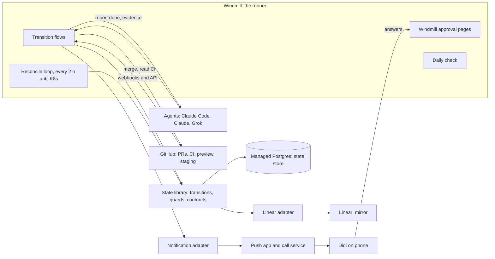
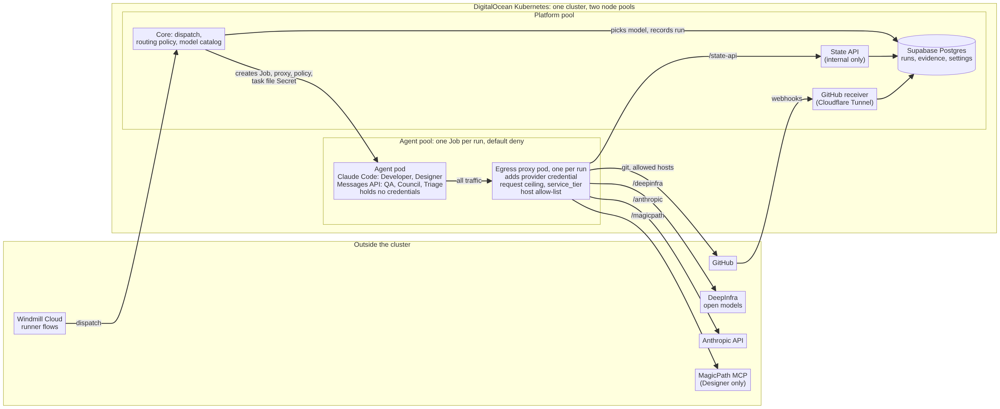

# Technical architecture

Status: draft, 2026-10-28. Items marked Proposed need an ADR and review. Items marked To verify need a spike before anything depends on them.

## 1. Overview

Four ideas shape the design:

1. The state store is the source of truth. Every other thing (Linear, approval pages, push alerts, the daily check, a future frontend) renders it.
2. The runner decides every transition. A transition is a guarded, transactional write. Agents propose by reporting; they never write state.
3. Contracts are data. Guards, evidence, timeouts and fallbacks are loaded at a version, not hard-coded in flows.
4. Plumbing is plain code. Models do judgment inside a state and nothing else.

## 2. Components

### 2.1 State library (core, plain TypeScript)

- Pure logic with no Windmill or HTTP dependency. Takes a store interface, a contracts object, a clock and an id source. It never reads the time or makes random values itself, so the same input always gives the same result (D-162).
- Exposes operations: create node, add edge, record evidence, record decision, open or supersede a gate request, request transition, run the reconcile pass, and read views (attention list, daily check data).
- `requestTransition(nodeId, toState, trigger, actor)` loads the node, finds the contract for the move, evaluates the guard against recorded evidence, and on success writes the transition row and updates the node in one transaction with the version check. It returns the result and the guard report.
- Everything else (flows, API, adapters) is a thin shell around it. This is where most tests live.

### 2.2 State store

Managed Postgres: Supabase in `ca-central-1` (ADR 0103). Schema in ADR 0104 and `db/migrations/`, in the `factory` schema with row level security on. Append-only tables are protected by triggers that reject UPDATE, DELETE and TRUNCATE for every role, and no application role has DELETE. Revisit when there is a Kubernetes cluster with a vault and replicas.

### 2.3 State API (tiny, Proposed)

A thin HTTP API over the library for agents, the viewer and adapters: create idea, record decision, report done with evidence, read a node, read the attention list. Hosting options for the M0 ADR: Windmill scripts exposed as endpoints, or a small service (for example a plain Node service; a Worker is allowed only if the code stays portable). Choose the simplest option that keeps agents from touching the database directly, and keep Cloudflare-specific APIs out of the API and the library (D-132). Agents authenticate with their own identity and can only write what their role allows.

### 2.4 Runner (Windmill)

- One flow per transition, plus the reconcile flow, event handlers for webhooks, and the daily check flow. Windmill's flow format is acyclic, and our machine has cycles (a QA failure sends work back), so durable state lives in the store and each flow handles exactly one transition.
- Flows are small. They call the library, call adapters, and write results. They contain no business rules.
- Every flow is idempotent. A repeated webhook or a retried run produces the same final state.
- Approval steps suspend a flow until resumed through a URL. They are the primary channel for gate approvals in v1 (To verify on a phone).

### 2.5 Reconcile loop

Runs every 2 hours until Kubernetes exists, then every 5 minutes once Windmill is self-hosted (setting `reconcile_interval_minutes`, D-111, D-164). It is the backstop for missed events. The runner counts Windmill executions per month and alerts Didi at 80% of the free limit (P-21). Each pass does, in order:

1. If `kill_switch` is true, stop.
2. Release: for each Blocked node whose blockers are all Done (and whose design spec is merged where required), request the transition to Ready.
3. Dispatch: for each node that is ready but has no active run, dispatch the owning bot. A ready item that is not running after one cycle is a bug, so it is put on the attention list and the daily check, and becomes a push alert after `stall_phone_alert_after_minutes`.
4. Advance from evidence: if an agent has pushed fixes and CI is green on the head commit, move the item to review and dispatch QA. If main has deployed to staging after a merge, dispatch the staging check.
5. Stall check: flag running items that stopped making progress (no run activity within the run's budget window).
6. Clean up: close gate requests that are no longer needed or are absorbed by a newer request on the same topic.
7. Mirror: dropped with the Linear mirror (D-192). The pass has no mirror step.
8. Spend: roll up cost per day, raise the alert threshold, and raise a call at `daily_spend_call_usd`.

In `dry_run` mode the pass computes the same plan but writes transitions with mode `dry_run` and acts on nothing. The pass also runs the GitHub polling backstop for each repository with dispatched work, before step 2 (ADR 0113 section 6). The dry-run pass is built in `src/core/reconcile.ts` (M2.4): it writes only `dry_run` transition rows and the evidence polling records, and stops if `dry_run` is false, since live mode is not built yet.

### 2.6 Contracts as data (Proposed)

- Contracts live in `contracts/` as YAML or JSON: states (purpose, input, output, evidence to exit, tools and permissions, budget, side effects, failure) and transitions (trigger, guard, timeout, fallback), for Machine 1 and Machine 2.
- Each guard is a named function in the library, referenced by name from the contract (for example `blockers_done`, `ci_green_on_head`, `qa_verdict_independent_on_head`, `privileged_paths_approved`, `prod_env_protected`, `approval_recorded`, `not_third_failed_round`). The full list of 24 is in ADR 0105 (D-176).
- The spec version is the git commit sha of `docs/spec.md` and `contracts/`. The runner records it in `spec_versions` and on every transition.
- A consistency test compares the transitions in the contracts with the transitions in `docs/spec.md`. A transition that exists in one and not the other fails CI.
- Whether the spec should generate Windmill flows automatically is open and deferred.

### 2.7 Adapters

Each integration sits behind an interface so it can be replaced.

| Adapter       | Does                                                                                                                                                                                               | Notes                                                                                                                                                                                                                                                                                                             |
| ------------- | -------------------------------------------------------------------------------------------------------------------------------------------------------------------------------------------------- | ----------------------------------------------------------------------------------------------------------------------------------------------------------------------------------------------------------------------------------------------------------------------------------------------------------------- |
| GitHub        | Reads PRs, CI results, preview and staging deployments, merge state. Merges PRs. Receives webhooks                                                                                                 | Bots and the runner act through separate GitHub Apps with their own identities and keys (D-156). The QA App reads only and cannot review; the runner posts QA's result as a check run (D-155, D-157, ADR 0112). Round counts come from the store                                                                  |
| Linear        | Creates and updates issues and statuses, mirrors the store                                                                                                                                         | Uses Linear's own API under the runner's app identity, not the MCP. To verify: that the API can create statuses and let an app act under its own identity. A one-time setup creates new statuses (Interview, Council planning, Escalated to Council, Escalated to Didi) and renames others (see the spec mapping) |
| Agent runtime | Starts an agent on a task and reads its result                                                                                                                                                     | One implementation per runtime: Claude Code (Developer), Claude with MCP tools (Designer, Council, Triage), Claude with a read-only file tool (QA for now, D-158, ADR 0112). The bot file names the runtime and model                                                                                             |
| Deploy        | Staging deploys and preview branches, through infrastructure as code (plan, then apply). Cloudflare Workers first, Kubernetes in the second release. The only place Cloudflare-specific code lives | Production deploys and production applies are not available to the runner. A plan with DNS changes, new secrets or wider permissions, or deletions goes through its gate first                                                                                                                                    |
| Notification  | Push alerts and incident calls                                                                                                                                                                     | Providers are chosen at build time after checking current pricing                                                                                                                                                                                                                                                 |
| Approval      | Creates Windmill approval pages and reads answers                                                                                                                                                  | Answers are saved as verbatim decisions. Links go only to Didi privately, expire quickly and close after one answer; the runner never relies on a link alone (D-170)                                                                                                                                              |

### 2.8 Agent execution environment (decided: ADR 0106, ADR 0107, ADR 0114)

Agents need somewhere to run. Options for the M3 ADR: a Windmill worker with the agent CLI, GitHub Actions, or a separate sandboxed runtime. Claude Code can be run non-interactively from a command line (check the current documentation for the headless mode or Agent SDK before depending on a specific flag). Requirements: one agent per item, scoped to one project's repo and credentials, no production access, budgets enforced from outside the agent (turn, minute and dollar limits), and a clean report-back path that records a run and evidence.

Decided: each run is a Kubernetes Job in the agent pool with its own egress proxy pod ([ADR 0106](../decisions/0106-agent-execution-environment.md)). The core picks the model at dispatch from the routing policy and the model catalog ([ADR 0114](../decisions/0114-model-evaluation-routing-and-tiers.md)). The agent holds no credentials: the proxy adds each provider's credential and is the only way out. There is no model gateway (D-217).

The diagram's source is [`agent-run.mmd`](./agent-run.mmd) (Mermaid). After changing it, render it again to `agent-run.png`.

### 2.9 Infrastructure as code (Proposed, D-133)

- Why: with deploys spread across Cloudflare it is hard to see what is set up and where. Declaring it in a repo makes that visible, and a plan is the exact diff a gate should show.
- Scope: each project's Cloudflare resources and DNS, the factory's own staging resources, and, where providers exist, the managed Postgres and GitHub settings.
- Tool: Terraform or OpenTofu (the open-source fork). Check current Cloudflare provider support for each. Decide in ADR 0110.
- State: a remote, locked backend, not in the repo. Check free tiers. Never put secret values in code, state output or plans. Pass secrets from the vault at apply time.
- Layout: an `infra/` module per project, ideally from Launchpad. The Launchpad change is outside this repo (N-15).
- Flow: a PR that touches `infra/` makes the runner run a plan and save its summary as evidence. If the plan includes DNS changes, new secrets or wider permissions, or deletions, the runner opens the matching gate request and attaches the plan. The runner applies only after approval. Production applies stay with Didi.
- Drift: the reconcile pass (or the daily check) runs a plan to detect drift and reports it. It does not apply.
- Existing resources: import them per project after cutover so the cutover is not delayed.
- Kubernetes: the planned second release (D-134). See section 2.10.

### 2.10 Preparing for Kubernetes (Proposed, D-134, ADR 0111)

The second release moves to Kubernetes for a pod per project, per-project isolation and monitoring, and eventually off Cloudflare. The first release does not build a cluster, except one small cluster with two node pools, following [ADR 0106](../decisions/0106-agent-execution-environment.md) (D-182, D-193): a platform pool for the state API and the GitHub receiver, and a tainted agents pool for agent runs. It is built so the switch is easy:

- Containers: the state API and the agent runners are container images with a Dockerfile. They read config only from the environment, expose a health endpoint, log structured JSON, and shut down cleanly. No platform-specific code. Kubernetes-specific code lives only in the Kubernetes agent runtime adapter, the cluster's infrastructure code, and the API and receiver deployment manifests (D-193).
- A target-agnostic deploy adapter: the operations are deploy, preview, health, logs and teardown, with a Cloudflare implementation first. Previews and staging are concepts in the adapter, not Cloudflare URLs in the code. A contract test runs against two targets (Cloudflare and a fake second one).
- The isolation model is defined up front: each project has its own boundary of credentials, secrets path (`projects/<slug>/...`), network rules and resource limits. In the first release the boundary is enforced by credentials and the secrets path. In the second it maps to a namespace with network policies and quotas.
- Secrets are referenced by path behind an interface: Windmill resources now, Vault later.
- Agent runtime adapters take the model endpoint and API key from the bot file as settings (the key as a secret path, never its value), so the model provider can change without code changes. Model providers are called directly, with no gateway; the self-hosted model gateway is dropped (D-217).
- The IaC layout separates platform modules from project modules. A project module takes a target (Cloudflare now, Kubernetes later), so a project can move without a rewrite.
- Monitoring hooks: structured logs, health endpoints, and the `runs` and `transitions` tables already provide the data. The monitoring stack (metrics, logs, dashboards, alerts wired into the existing alert and call tiers) arrives in the second release.
- The second release is its own project, run through the factory with the Interview first. It is outlined in Milestone 7 of the build plan and not detailed here.

### 2.11 Decision points (Proposed, P-11, P-12)

- Every place the system classifies or picks something (for example the Triage track, severity, the size of a visual tweak, the interview depth, escalation severity, model routing) is a named interface in `src/core/` that returns a typed result with a confidence value.
- A rule or a Claude Sonnet call fills it now. The interface lives in the core and the implementations live in an adapter, so the core stays free of model calls (essentials 4 and 5).
- Each decision is recorded with the decider id, a hash of the input, the output, the confidence and, later, the outcome. The record never holds personal data or secrets. This builds a labelled history and lets a decision model replace the rule or the Sonnet call without changing flows.
- A model only advises. It never authorizes a transition (essential 1). A low confidence result falls back to the Council. LLM-as-a-judge output is evidence for a guard, never a verdict on its own, and workflow branching by a model is a recommendation the guard and the runner decide on (P-12).
- Release 3 (D-216) adds decision models for: model routing and cascades (with routing in the core, ADR 0114, and the spend alerts), classification, guardrails, LLM-as-a-judge, context compaction and memory management (with the deferred context graph, N-14), search and rerank, and tool selection inside a role's allowed toolbox.

### 2.12 Machine 3: the Scanner (Proposed, D-150, P-13 to P-16)

The loop: the Scanner finds something, files it as an idea, the idea enters Machine 1, Triage splits it into work items, Machine 2 builds them, and Didi deploys to production. The Scanner is a scheduled, read-only run. It never changes code, never opens PRs and never creates gate requests directly.

- Sources (P-15): failing or flaky tests, vulnerable or stale dependencies, mutation survivors, error patterns, spec-versus-code and docs-versus-behaviour drift, IaC drift from a plan, contracts-versus-spec consistency, Linear mirror mismatches, repeated failure patterns from the counters, guards that fail often, spend spikes from the `runs` table, and test gaps. Large code scans may read the codebase recursively, with a recursion depth limit in the bot budget.
- Idea fields (P-14): source tag `scanner`, class (bug, drift or improvement), evidence references (file and line, test output, plan output, run ids), a confidence value and a dedupe key.
- Safeguards (P-14): duplicates of an open idea or work item are merged, a cap on new ideas per scan, a confidence threshold, and a scan budget (turns, minutes, dollars). The Scanner reads untrusted code and comments, so its output is advice only: every proposal still passes the Council or a gate (essential 1).
- Intake by class (P-13): bugs and drift are sized by the Council, with no Interview unless product behaviour is unclear. Improvements that add a feature, change a user flow or change product direction go to Didi and get an Interview (D-008, D-014).
- Timing (P-16): after cutover has run stably for a few weeks. It does not need Kubernetes and is independent of RSI. Schedule, scope, caps, threshold, budget and model are O-12.

### 2.13 Self-improvement (Proposed, D-149, D-151, D-152, P-17 to P-19)

Self-improvement comes in stages (D-151). Stage A is the Scanner (section 2.12). Stages B to D are recursive self-improvement (RSI) Levels 1 to 3, planned for release 4 or later (D-152). Production deploys stay Didi's (D-007, D-149).

| Stage | Level   | What                                                                                                                                                                                                                       | Needs                                             |
| ----- | ------- | -------------------------------------------------------------------------------------------------------------------------------------------------------------------------------------------------------------------------- | ------------------------------------------------- |
| A     |         | Machine 3 produces ideas, including ideas about the factory itself, which run through the normal flow as dogfooding. Didi deploys                                                                                          | Section 2.12                                      |
| B     | Level 1 | The system proposes changes to its own playbook, bot files, prompts and contract thresholds (including QA thresholds, D-153) as ordinary ideas, tests them by replaying recorded history and by shadow runs. Didi approves | No Kubernetes. Decision-point records (P-11)      |
| C     | Level 2 | Changes to the factory's own code run in an isolated sandbox, deploy to staging, run against the current version, and roll back automatically on regression. Production promotion stays a gate                             | Kubernetes (section 2.10)                         |
| D     | Level 3 | Didi's call later: auto-promotion for narrow, low-risk classes of change, never for the protected set                                                                                                                      | Stage C, an explicit decision per class of change |

Protected set (P-18). The system may never change these without Didi:

- the gate list and its enforcement code
- the guards that authorize transitions, and the privileged-path list
- the runner's credentials and how they are issued
- the metrics and the evaluation harness
- spend caps and the kill switch
- the rule that production deploys are Didi's
- this list itself

It is enforced through the privileged-path list and the merge guard.

RSI rules (P-19):

- Every self-change is an ordinary Machine 2 work item with the same QA, evidence and merge guard.
- The proposer, the evaluator and the deployer are different roles, and the evaluator is a different model family. A model never grades its own change.
- One improvement is in flight at a time, and every change is small and reversible.
- Success is judged on several outcomes (cycle time, failures, QA rounds, spend) with a held-out slice.
- QA strictness and thresholds are in the protected set: the system may propose changes to them, and only Didi approves them (D-153).

The first release already records what RSI needs: transitions, evidence, runs with bot and model version, counters, decisions, the spec version on every transition, and the decision-point records (P-11). Still missing: an outcome view per work item (cycle time, failures, QA rounds, spend), a replay harness, and an experiment tag on runs.

## 3. Key flows

### 3.1 Code track item

1. Ready for dev: the reconcile loop (or the entry event) dispatches the Developer. Guard: no open blockers, no pending gate request on the item, agent-ready, not on hold. The run is recorded.
2. The agent works on a branch and opens a PR. It reports done with the PR link.
3. The runner reads CI for the head commit and checks docs. If the guard passes, the item moves to In QA review and QA is dispatched. If not, it stays In development and `failure` increases by one.
4. QA checks the preview branch (a different model family; waived while QA runs on Claude, D-158) and reports a verdict through the state API, which binds it to the head commit. The runner posts it on the PR (ADR 0112). Evidence is recorded.
5. On pass, the runner checks the merge guard (CI on head, no conflicts, privileged paths approved, production environment protected where relevant) and merges. The substate becomes `verifying_on_staging`.
6. Main deploys to staging. A bot checks staging. On pass the item is Done and dependents are released. On fail the item returns to In development and `failure` increases by one.
7. Three failures, or three failed QA rounds, send the item to Escalated to Council.

### 3.2 Design track item

Ready for design exploration, In design exploration (visual options), Waiting for Didi (visual approval, or the Council for a small tweak), Writing spec (Designer only edits `design/<area>/<feature>/`), Building components, In QA review on the preview branch, merge by the runner, Verifying on staging, Done. On Done the runner adds a Spec section to the linked developer item (merge commit, paths on main, final decisions) and releases it.

### 3.3 Gate request

1. A guard or an agent report needs a human or the Council. The library opens a gate request with a topic key (superseding any open request on the same topic) and a payload.
2. A Windmill approval page is created. A blocking request also raises a push alert with the link.
3. Didi answers. The answer is saved as a verbatim decision with a scope (for example one exact commit, one option, one request). The suspended flow resumes.
4. If the answer reverses an earlier approval, dependent nodes become stale and a Council question opens.

### 3.4 Cutover

See `docs/cutover.md`.

## 4. Security model

| Actor              | Can                                                                                                                      | Cannot                                                                                                                               |
| ------------------ | ------------------------------------------------------------------------------------------------------------------------ | ------------------------------------------------------------------------------------------------------------------------------------ |
| Runner             | Read and write the state store. Read CI, merge PRs. Write Linear through its API. Deploy to staging                      | Deploy to production. Hold any credential beyond these without the new-credentials gate. Reach real personal data without a PII gate |
| Developer agent    | Read and write one project's repo branches, open PRs, read CI                                                            | Merge. Reach production or remote databases. Print secrets. Change the spec directory                                                |
| Designer agent     | Edit `design/<area>/<feature>/` and gallery components for one project. Use the MagicPath canvas through MCP and exports | Edit anything else. Read MagicPath comments in v1 (needs a signed-in browser)                                                        |
| QA agent           | Read PRs, CI, preview and staging. Post verdicts under its own identity                                                  | Merge. Edit code                                                                                                                     |
| Council and Triage | Read the status view of all projects, create plans, work items and decisions                                             | Read other projects' code or secrets. Move states directly                                                                           |
| Didi               | Everything gated to him                                                                                                  |                                                                                                                                      |

Rules:

- No secret values in chat, repos, Linear, logs or transcripts. Secrets live in the vault or Windmill resources.
- Temporary credentials for personal data: Didi approves one request, the runner mints or enables a credential whose expiry (default 60 minutes) is set and enforced by the runner, not chosen by the agent.
- Every bot and agent has its own identity so no action looks like Didi's.
- Privileged paths (migrations, PII, privacy, deploy workflows, `.github`, secrets) are listed in Launchpad as a default, and each repo can add to it. The runner decides from the list, never the bot.
- Toolbox: each tool declares a side-effect type (read, write, needs approval, only Didi). The runner refuses to call a needs-approval tool without an approval attached, so gates are enforced by the toolbox itself.

## 5. Observability

- The `transitions` log explains every state. The `evidence` table explains every guard.
- The `runs` table records model, turns, minutes, cost and outcome. Spend and stall checks read it.
- The daily check is generated from the store, grouped by project and ordered by what blocks the most work.
- The attention list is a view of `gate_requests` and stalls. Channels only render it.
- Alerts: push for blocking gates and long stalls; a phone call for a failed production health check, data loss or PII exposure flagged by a bot, and daily spend over the set amount.

## 6. Failure modes

| Failure                                   | Handling                                                                                                                        |
| ----------------------------------------- | ------------------------------------------------------------------------------------------------------------------------------- |
| Missed or duplicate webhook               | Reconcile loop catches it. Flows are idempotent                                                                                 |
| Two runner jobs move the same item        | The version check makes one fail. It retries from a fresh read                                                                  |
| Model usage exhausted                     | Plumbing is code and keeps running. Dispatches queue and resume. Runs record `usage_exhausted`. No run is killed mid-transition |
| Linear unavailable or out of sync         | The runner continues. The mirror lags and reports a mismatch. It never overwrites silently                                      |
| Agent loops or burns budget               | The run stops at its budget. The item goes to Escalated to Council                                                              |
| QA verdict for an old commit              | Ignored. A verdict applies only to the PR's current head commit                                                                 |
| Approval pages unreachable                | Email digest and Linear view still show the attention list. Production deploys can still be approved on GitHub                  |
| Runner misbehaves                         | Kill switch pauses all transitions and dispatch. Grok routines are disabled, not deleted, so they can be re-enabled             |
| Grok or another runtime cannot be started | QA moves to another non-Claude agent. The bot file makes the model a setting                                                    |
| Reversed approval                         | Dependents marked stale, a Council question opens, nothing continues on the stale basis                                         |

## 7. Deployment

- Windmill Cloud for the runner. Managed Postgres for the state store. The API location is set in ADR 0102, amended by D-193. Infrastructure is declared as code (section 2.9).
- The API and agent runners ship as containers. In the first release they run on one small DigitalOcean Kubernetes cluster with two node pools ([ADR 0106](../decisions/0106-agent-execution-environment.md), D-193). The state API and the GitHub receiver run on the platform pool. Agent runs go to the agents pool, which is tainted so nothing else runs there. Only the receiver takes traffic from the internet, through a Cloudflare Tunnel; the state API is internal (D-195). Supabase stays the database and Windmill Cloud stays the runner. The second release adds self-hosted Windmill, Vault, the model gateway, monitoring, GitOps and project deploys (section 2.10).
- The factory is its own first project. Its production deploys stay with Didi. Gates stay fully on during bootstrap.
- Environments: a staging project used for rehearsals, and the real projects. A rehearsal never touches real projects.

## 8. Architecture decisions to write as ADRs

| ADR  | Decision                                                                                   | When              |
| ---- | ------------------------------------------------------------------------------------------ | ----------------- |
| 0101 | Repo layout, language and tooling (TypeScript, test runner, lint, CI, pinned dependencies) | M0                |
| 0102 | State API hosting and agent authentication                                                 | M0                |
| 0103 | Managed Postgres provider and region                                                       | M0                |
| 0104 | Final column-level schema, the reversal mechanism for decisions, counter rules             | M1 (review point) |
| 0105 | Contracts format and consistency test                                                      | M2                |
| 0106 | Agent execution environment and budget enforcement                                         | M3                |
| 0107 | Dispatch adapters per runtime and the Grok verification result                             | M0 spike, M3      |
| 0108 | Linear adapter, statuses setup and app identity                                            | M5                |
| 0109 | Notification providers                                                                     | M4                |
| 0110 | Infrastructure as code: tool, state backend, secrets handling, layout                      | M0 (M0.7)         |
| 0111 | Conventions that make the move to Kubernetes cheap                                         | M0 (M0.8)         |
| 0112 | QA runtime, GitHub access and independence                                                 | M0, built in M3.2 |
| 0113 | GitHub evidence ingestion                                                                  | M2 (M2.3)         |
| 0114 | Model evaluation, routing and service tiers                                                | M3.2, M4.5        |
